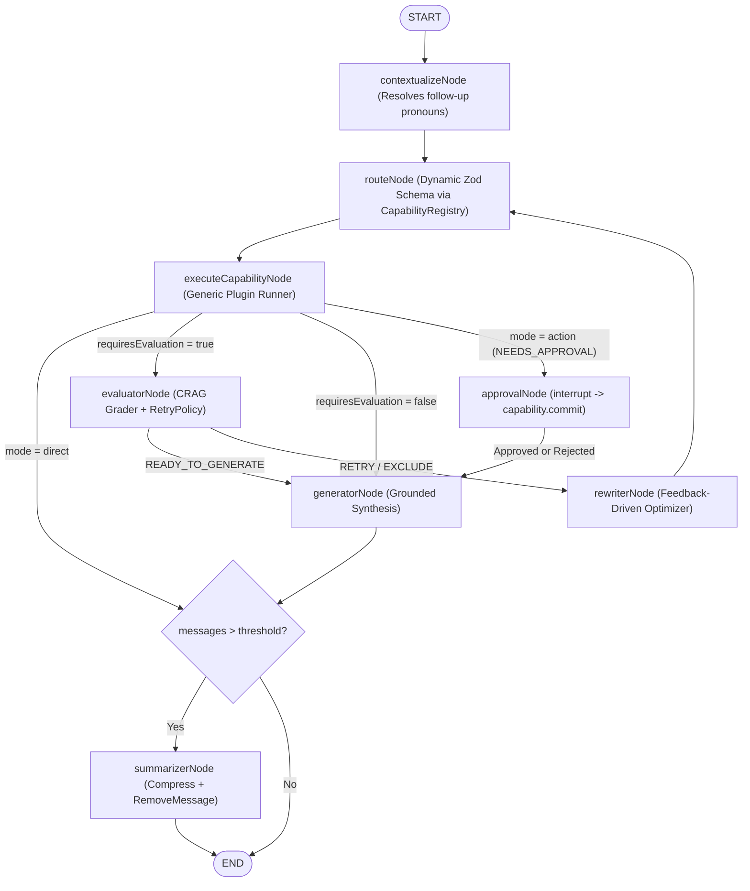

# LangGraph Adaptive CRAG Orchestrator

A full-stack, production-grade AI agent built with **Node.js (ES Modules)**, **Express 5**, **LangGraph.js**, **Groq (`openai/gpt-oss-120b`)**, **Google Gemini Embeddings (`gemini-embedding-001`, 3072 dimensions)**, and **MongoDB Atlas Local Vector Search (`$vectorSearch`)**.

It combines **Adaptive Routing**, **Corrective RAG (CRAG)** with self-healing query rewriting, **Multi-Turn Pronoun Contextualization**, **Rolling Conversation Summarization (`RemoveMessage`)**, **3-Tier Live Web Search**, and **Human-in-the-Loop (`interrupt` + `Command`) Action Approvals** behind a real-time **Server-Sent Events (SSE)** streaming UI.

---

## Key Architecture & Features

- **Open/Closed Plug-and-Play Capability Registry (`src/capabilities/`)**
  - Capabilities self-register with `CapabilityRegistry` (`mode: "direct" | "context" | "action"`, `requiresEvaluation: boolean`).
  - `AdaptiveRouter` dynamically builds its Zod routing schema at runtime from registered capabilities—adding a new capability requires **zero** edits to graph nodes or edges.
- **Multi-Turn Query Contextualizer (`src/services/queryContextualizer.js`)**
  - Resolves follow-up pronouns (*"Can I spend it on a standing desk?"* → *"Can I spend the NovaTech \$1,500 annual equipment allowance on a standing desk?"*) before routing or retrieval, with a `0ms` fast-path bypass on Turn 1.
- **Native MongoDB HNSW Vector Search (`src/db/vectorStore.js`)**
  - Powered by `mongodb/mongodb-atlas-local` in Docker (`mongod` + `mongot` search engine) with asymmetric Gemini embeddings (`RETRIEVAL_DOCUMENT` for ingestion, `RETRIEVAL_QUERY` for search) and `3072`-dimension cosine similarity indexing.
- **Corrective RAG (CRAG) Loop (`evaluatorNode` + `rewriterNode` + `RetryPolicy`)**
  - Grades retrieved context for relevance; if irrelevant or incomplete, rewrites the search query, retries up to `maxRetries`, and automatically excludes exhausted capabilities to fall back cleanly (e.g., to Live Web Search).
- **Human-in-the-Loop (HITL) Approvals (`WorkspaceActionCapability` + `approvalNode`)**
  - Separates **LLM Action Drafting** (`executeCapabilityNode`) from **Human Confirmation & DB Commit** (`approvalNode` using `interrupt()` and `new Command({ resume })`), rendering interactive **Approve / Reject** cards in the chat UI with zero duplicate LLM calls on resume.
- **Rolling Memory Summarization (`src/services/memorySummarizer.js`)**
  - Uses LangGraph's `messagesStateReducer` and `RemoveMessage` to compact older turns into `conversation_summary` once message count exceeds the configured threshold (`10`), keeping long conversations fast and within token limits.
- **IIS Reverse-Proxy & PM2 Ready (`iis/web.config` + `ecosystem.config.cjs`)**
  - Pre-configured for Windows IIS (`URL Rewrite` + `Application Request Routing`) with unbuffered SSE streaming and PM2 background daemon management.

---

## Architecture Diagram



---

## Project Structure

```text
Chat/
├── concept/                              # Standalone learning & test scripts
│   ├── knowledge.txt                     # Source knowledge base document for RAG ingestion
│   ├── test-hitl.js                      # Standalone Human-in-the-Loop (interrupt + Command) demo
│   └── ...                               # Additional LangGraph & RAG concept sandboxes
├── iis/
│   └── web.config                        # Isolated IIS Reverse Proxy gateway config (URL Rewrite + ARR)
├── public/                               # Vanilla HTML/CSS/JS Frontend
│   ├── index.html                        # Main application layout
│   ├── style.css                         # Dark-theme styling & HITL Approval Card styles
│   ├── app.js                            # SSE stream reader, Markdown renderer & HITL resume handler
│   ├── speech.js                         # Browser Web Speech API (Voice-to-Text) helper
│   └── tools.js                          # Tool status badge metadata helper
├── src/
│   ├── config/
│   │   └── index.js                      # Centralized dotenv loader + Zod fail-fast validator + frozen config
│   ├── agent/
│   │   ├── state.js                      # LangGraph Annotation.Root state & reducers
│   │   ├── nodes.js                      # Graph nodes (contextualizer, router, executor, approval, CRAG, summarizer)
│   │   ├── edges.js                      # Conditional routing edges
│   │   ├── graph.js                      # Compiled StateGraph with MongoDBSaver checkpointer
│   │   └── policies/
│   │       └── retryPolicy.js            # Per-capability retry counter & exclusion policy
│   ├── capabilities/
│   │   ├── BaseCapability.js             # Abstract base class (execute + commit lifecycle)
│   │   ├── CapabilityRegistry.js         # Plugin registry & dynamic Zod AdaptiveRouter
│   │   ├── DirectCapability.js           # Conversational & general LLM knowledge plugin (mode: "direct")
│   │   ├── VectorDocsCapability.js       # Internal knowledge base RAG plugin (mode: "context", evaluated)
│   │   ├── WebSearchCapability.js        # Live internet search plugin (mode: "context")
│   │   └── WorkspaceActionCapability.js  # HITL action submission plugin (mode: "action")
│   ├── db/
│   │   ├── connection.js                 # Singleton MongoClient & collection helper
│   │   ├── checkpointer.js               # LangGraph MongoDBSaver thread persistence
│   │   ├── vectorStore.js                # VectorStoreRepository ($vectorSearch + HNSW index management)
│   │   └── ingest.js                     # Document chunking & batch embedding ingestion script
│   ├── services/
│   │   ├── embeddings.js                 # Gemini 3072-dim RETRIEVAL_DOCUMENT & RETRIEVAL_QUERY embeddings
│   │   ├── evaluator.js                  # CRAG context relevance grader
│   │   ├── queryContextualizer.js        # Multi-turn follow-up query rewriter
│   │   ├── queryRewriter.js              # Search retry query optimizer
│   │   └── memorySummarizer.js           # Rolling conversation history compressor
│   ├── tools/
│   │   ├── docsTool.js                   # VectorStoreRepository query wrapper
│   │   └── webSearchTool.js              # 3-Tier Web Search (Tavily -> Groq Compound -> DuckDuckGo)
│   └── utils/
│       └── portFinder.js                 # Dual-stack IPv4/IPv6 automatic free port detector (dev mode)
├── docker-compose.yml                    # Local MongoDB Atlas (mongod + mongot vector search) container
├── ecosystem.config.cjs                  # PM2 production background process configuration
├── server.js                             # Express 5 server & SSE streaming endpoints (/api/chat, /api/chat/resume)
└── package.json                          # Project dependencies & scripts
```

---

## Prerequisites

1. **Node.js** `v20+` (developed & tested on `v24.11.1`)
2. **Docker Desktop** (required to run `mongodb/mongodb-atlas-local` for local `$vectorSearch` indexing)
3. **API Keys**:
   - **Groq API Key** (`GROQ_API_KEY`) — for ultra-fast LLM inference (`openai/gpt-oss-120b`)
   - **Google Gemini API Key** (`GOOGLE_API_KEY`) — for `gemini-embedding-001` (`3072`-dim vector embeddings)
   - **Tavily API Key** (`TAVILY_API_KEY`, *optional*) — primary tier for live web search

---

## Step-by-Step Installation & Setup

### 1. Clone & Install Dependencies

```powershell
npm install
```

### 2. Configure Environment Variables (`.env`)

Create a `.env` file in the project root:

```env
NODE_ENV=development
PORT=3000
MONGODB_URI=mongodb://localhost:27018/?directConnection=true
DB_NAME=chatbot_db
GROQ_API_KEY=your_groq_api_key_here
GOOGLE_API_KEY=your_google_gemini_api_key_here
TAVILY_API_KEY=your_tavily_api_key_here
```

> **Why `?directConnection=true` on port `27018`?**
> `mongodb-atlas-local` runs an internal single-node replica set (`mongodb:27017`). Adding `?directConnection=true` ensures the Node.js driver connects directly through mapped host port `27018` without redirecting to the container's internal hostname.

### 3. Start MongoDB Atlas Local (Docker)

Make sure **Docker Desktop** is running, then launch the database container:

```powershell
docker compose up -d
```

Verify the container is `healthy`:

```powershell
docker ps --filter "name=chat_atlas_local"
```

### 4. Ingest the Knowledge Base & Build the HNSW Vector Index

Run the ingestion script once to chunk `concept/knowledge.txt`, generate `3072`-dimension Gemini embeddings, store them in `chatbot_db.knowledge_chunks`, and automatically build the `vector_index` HNSW search index:

```powershell
node src/db/ingest.js
```

> **Customizing the Knowledge Domain:**
> If you replace `concept/knowledge.txt` with documents for a different company or topic, re-run `node src/db/ingest.js` and update the domain description in `src/capabilities/VectorDocsCapability.js` (and `src/tools/docsTool.js`) so the router knows what topics live in your vector database.

---

## Running the Application

### Option A: Development Mode

```powershell
npm start
# or: node server.js
```

- In `development` mode, `src/utils/portFinder.js` automatically binds to `PORT` (`3000`) or hops to the next available port (`3001`, etc.) if `3000` is busy.
- Open the printed URL (e.g., `http://localhost:3000`) in your browser.

### Option B: Windows IIS Reverse Proxy + PM2 Production Mode

1. **Start the Node.js backend via PM2** (binds strictly to `PORT: 4500` in `production` mode):
   ```powershell
   npx pm2 start ecosystem.config.cjs
   ```
2. **Ensure IIS Website (`LangGraphChat`) is started** in IIS Manager (`inetmgr`):
   - **Physical path:** `d:\Personal Projects\Chat\iis` (isolated gateway containing `web.config`)
   - **Binding port:** `8095` (forwards traffic via URL Rewrite + ARR to `http://127.0.0.1:4500`)
   - **ARR Server Proxy Settings:** `Enable proxy` checked, `Response buffer threshold (KB)` set to `0` for unbuffered live SSE token streaming.
3. Open **`http://localhost:8095`** in your browser.

#### Useful PM2 Commands

```powershell
npx pm2 list                    # View status, PID, CPU, and RAM usage
npx pm2 logs langgraph-chat     # Stream live server logs (Ctrl+C exits log view only)
npx pm2 restart langgraph-chat  # Restart after backend code changes
npx pm2 stop langgraph-chat     # Pause the background service
npx pm2 kill                    # Shut down PM2 daemon completely
```

---

## API Endpoints

| Method | Endpoint | Description |
| :--- | :--- | :--- |
| `GET` | `/api/history/:sessionId` | Returns persisted chat history (`messages`) and any active `pendingInterrupt` for the thread from MongoDB checkpoints. |
| `POST` | `/api/chat` | Accepts `{ message, sessionId }` and streams SSE events (`tool_start`, `tool_end`, `token`, `interrupt`, `done`, `error`). |
| `POST` | `/api/chat/resume` | Accepts `{ decision, sessionId }` (`"approve"` or `"reject"`) to resume a paused LangGraph `interrupt()` via `new Command({ resume: decision })`. |

